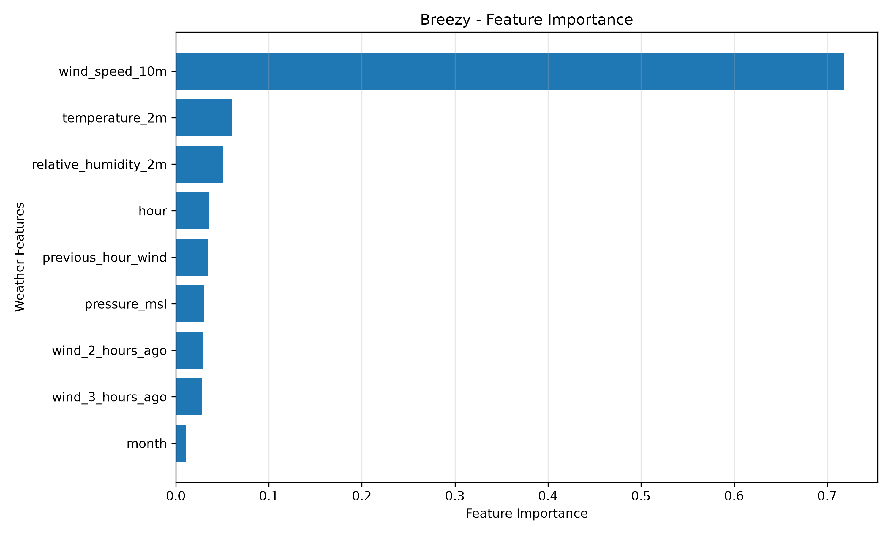
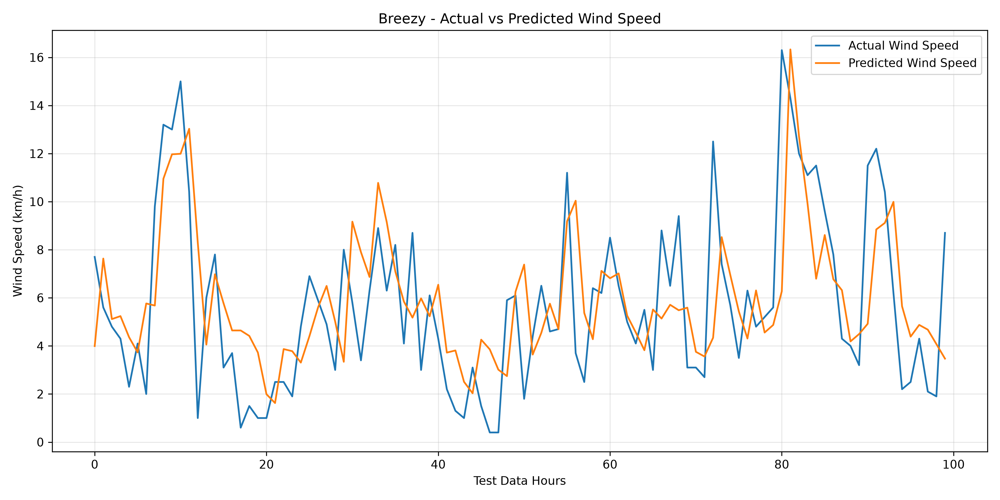

# 🌬️ Breezy
### Predict the wind. Visualize the flow.

Breezy is a machine learning project that explores wind patterns and predicts future wind speed using historical weather data.

The goal is to transform weather data into meaningful predictions and eventually visualize wind movement through an interactive application.

**Currently, Breezy focuses on historical weather analysis and one-hour-ahead wind speed prediction.**

---

## 🎯 Project Goals

- 🌬️ Predict future wind speed.
- 🧭 Explore and eventually predict wind direction.
- 📊 Analyze historical wind patterns.
- 🗺️ Visualize predicted wind flow on an interactive map.
- 📈 Compare predicted and actual wind conditions.
- 🤖 Experiment with machine learning models.

## 🚧 Project Status

**Currently in development.**

### Completed
- [x] Collected historical weather data using the Open-Meteo API.
- [x] Cleaned and explored the dataset.
- [x] Analyzed historical wind patterns.
- [x] Visualized wind speed and weather trends.
- [x] Performed feature engineering.
- [x] Built a Random Forest regression model.
- [x] Implemented one-hour-ahead wind speed prediction.
- [x] Evaluated model performance.
- [x] Visualized feature importance.
- [x] Compared actual and predicted wind speeds.

### Upcoming
- [ ] Improve prediction accuracy.
- [ ] Experiment with additional machine learning models.
- [ ] Develop wind direction prediction.
- [ ] Build a prediction API using FastAPI.
- [ ] Develop a React frontend.
- [ ] Create interactive wind maps.
- [ ] Add animated wind-flow visualization.
- [ ] Deploy the application.

---

## 🛠️ Technology Stack

### Data Collection
- Python
- Open-Meteo API
- Requests

### Data Analysis
- Pandas
- NumPy
- Matplotlib

### Machine Learning
- Scikit-learn
- Random Forest Regression

### Development Tools
- Jupyter Notebook
- Visual Studio Code
- Git
- GitHub

### Planned Technologies
- FastAPI
- React
- Leaflet
- XGBoost

---

## 📊 Dataset

The initial dataset was collected using the **Open-Meteo Historical Weather API**.

| Details | Description |
|---|---|
| Location | Kozhikode, Kerala, India |
| Data period | March – August 2026 |
| Total records | 4,416 hourly records |
| Data frequency | Hourly |

### Weather Features

- Temperature (2m)
- Relative humidity
- Atmospheric pressure
- Wind speed (10m)
- Wind direction (10m)

The dataset is used to explore historical weather patterns and train the prediction model.

---

## 🧠 Machine Learning Model

Breezy currently uses a **Random Forest Regressor** to predict wind speed one hour ahead.

### Prediction Workflow

1. Collect historical weather data.
2. Preprocess and explore the dataset.
3. Extract time-based features.
4. Create lag features using previous wind speeds.
5. Prepare training and testing datasets.
6. Train the Random Forest model.
7. Generate one-hour-ahead predictions.
8. Evaluate predictions against actual wind speeds.

### Model Features

The model uses nine input features:

- Temperature
- Relative humidity
- Atmospheric pressure
- Hour
- Month
- Current wind speed
- Previous hour's wind speed
- Wind speed two hours ago
- Wind speed three hours ago

The dataset is divided chronologically:
- Training data: 80%
- Testing data: 20%

---

## 📈 Model Performance

The initial Random Forest model achieved the following results on the test dataset:

| Evaluation Metric | Result |
|---|---:|
| Mean Absolute Error (MAE) | 2.10 km/h |
| Root Mean Squared Error (RMSE) | 2.72 km/h |
| Baseline MAE | 2.38 km/h |

The baseline uses the current wind speed as the prediction for the next hour.

The Random Forest model reduced the test MAE by approximately **11.8% compared with this baseline**.

These are preliminary results from a historical dataset. Further testing on later unseen weather data is needed to evaluate real-world forecasting reliability.

### Visualizations

**Feature Importance**



**Actual vs Predicted Wind Speed**



---

## 📂 Project Structure

```text
breezy/
│
├── app/
│
├── data/
│   ├── weather_data.csv
│   ├── wind_speed_graph.png
│   ├── feature_importance.png
│   └── prediction_comparison.png
│
├── models/
│
├── notebooks/
│   └── 01_wind_data_exploration.ipynb
│
├── src/
│   ├── get_weather.py
│   ├── analyze_weather.py
│   ├── data_summary.py
│   └── main.py
│
├── .gitignore
├── LICENSE
└── README.md
```

---

## 🔮 Future Possibilities

Future versions of Breezy aim to include:

- Location-based wind predictions.
- Hour-by-hour forecasts.
- Wind direction prediction.
- Interactive wind maps.
- Animated wind particles.
- Historical wind analysis.
- Prediction confidence estimates.
- Extreme wind alerts.
- Coastal and terrain-aware predictions.
- Real-time weather data.
- Mobile application.

---

## ⚠️ Disclaimer

Breezy is an experimental machine learning project developed for educational and research purposes.

Its predictions are based on historical weather data and may differ from actual weather conditions. They should not be used for safety-critical decisions.

---

## 👩‍💻 Author

**Fathima Fida**

Computer Science Graduate | Aspiring AI & Software Developer

Built as a learning project exploring machine learning, weather data, Python, and data visualization.

---

⭐ If you find this project interesting, consider giving the repository a star!